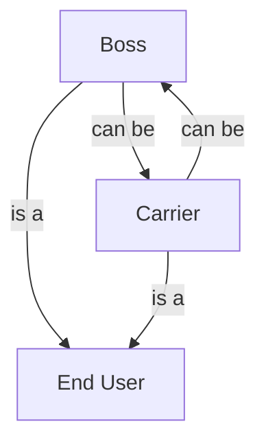

---

title: Tutorial
layout: page

---

## Tutorial for adelphos

Adelphos is a federated system in which users exchange goods and services
but they are *not* isolated, as in similar systems like eBay.

### Types of users

In adelphos users are grouped in families and families can form bigger
families, moreover families do not use external entities (like FedEx or
DHL), but rely on special members (called *carriers*) who will *route*
physically the object between families.

The family is able to gain credit using the exchange, either if it exports
the object and also if it imports it.

This poses the need for adelphos to have different roles in adelphos; in
this first version of adelphos we have three roles in a family

    - User

    - Boss

    - Carrier

As we can have a family of one member, Boss and Carrier are inclusive, that
is a user can be both a boss and a carrier for a certain family, but
conceptually they are different roles.

We could say:

# First step, create or join a family, the level zero

In adelphos the first step is to create a family; while in other
social platform the maximum granularity is the user (users can form
nets and groups, but they are not enforced), in adelphos the maximum
split is the family.

Inside the family there can be different members, but from the point
of view of adelphos they are ONE.

Putting this in monetary terms the family, the level zero, has only
one account and has a trust of infinity.

In adelphos every user is part of a family, this family can be part of
other families too, much like a folder in a file system can be inside
of another folder until we reach the root folder ( '/' in Linux/Unix
systems, a drive letter such as C: or D: in Windows).

Why this emphasis on level *zero*? Well, because, as we will see, the
number of the level determines also what happens when a person in that
family gains or loses something.

Just to start the topic (we will later return into it in more detail)
in level zero trust is infinity and the brotherhood constant (Beta) is
one.

We have already touched the trust, this means that in adelphos, much
like it happens in real life (or should happen!), the family members
have *completely* trust in one another and, at the same time, they are
*completely* responsible for the losses of the other (at least the
adult members).

If the wife damages the family car, all the family is liable.

If the husband goes bankrupt in some cases all the family assets are
withdrawn from the creditors (unless he has a limited liable
company... but this is another story).

This is the meaning of the brotherhood constant: Beta = 1.0 means
exactly that: all members of the family share completely losses and
gains.

To put it all together you join adelphos by two ways

    * you create your own family (level zero)

    * you receive an invite to join a family (always in level zero)

In the following example we assume that two users Carlo Rossi and
Maria Verdi, husband and wife, want to create a family in adelphos.

They have to decide who will start it: there is actually no
difference, because the first will be automatically the boss and the
carrier, but it can be changed later.

Suppose that the wife Maria wants to create the family. First of all
she has to have an account in Mastodon.  There are literally hundreds
of Mastodon instances in the world, anyone is OK, for the sake of the
example, and also because I am Italian, I have chosen mastodon.uno
which is the largest Italian Mastodon instance)

Given that adelphos speaks the ActivityPub protocol you could sign
also in another social in the fediverse (there are others); it must
only implement the inbox feature (which usually any social does), but
I have tested it only with Mastodon, so, unless you want to test and
debug, please remain with Mastodon!

Maria creates a user in Mastodon which is in form @user@host (notice
the double @ sign to distinguish from an email address), for example
@maria_verdi@mastodon.uno

Now she wants to create another *version* of herself in adelphos which
I have called an *alias*. This because I give the user the opportunity
to create different alias of himself in adelphos (there is a reason
for it, but it will be clear later) all of them from a single mastodon
account.

To create an alias in adelphos you send a message to the adelphos
instance; adelphos, in the fediverse, is just an ActivityPub user
which has name adelphos and is hosted by the adelphos instance.

In technical terms adelphos is a daemon which listens to messages sent
to its inbox, but for not technical people you can imagine adelphos as
a call center clerk that listen to incoming calls using a particular
address, a fediverse handle, the one with the double @ sign.

For example the adelphos user of www.adelphos.it is
@adelphos@www.adelphos.it.

You can contact the adelphos user by using the "private mention"
feature of Mastodon.

Login to Mastodon, you will see on the left a box in which you can
type a message, there are at least three options to create a message:
public, follower and private.

Choose private. Mastodon will warn that the message is not encrypted
end-to-end. This is OK, because this is only a create message. The
real communication will happen in a private chat, as we will see
later.

The message will be like this:

@adelphos@www.adelphos.it alias.create alias maria.verdi password maria01

Let's analyze it.

The first part: @adelphos@www.adelphos.it is the mention. It tells
mastodon where to send the message.

alias.create is the command.

Then there are the parameters, in the form of <key> <value>

So the message could be translated in English like this: "Create an
alias maria in the family verdi in the adelphos instance
www.adelphos.it. This alias has a password maria01.

If all is OK you will receive shortly a notification from the adelphos
daemon like this:

    Alias created, you can login now.

At this point you can login. In the next lesson we will start to use
the adelphos CLI interface.

Suppose that we invite @maria@ (mastodon.uno e).

# Create a family

# Invite a user in your family

When you create a user (alias) in adelphos you are automatically the boss
and the carrier of your family.

The family is of *level zero*.

The first thing to do is to invite other users to join your family.

Remember that in adelphos the level zero is the level in which all the
gains and the losses are shared 100% to the other members and trust is
infinite.

So do **not** invite a friend in your family of level zero unless you trust
him completely. Remember: you will be liable for all the expenses and
he/she will have access to all of your gains.

Your new family member need to have an handle in the fediverse with
Mastodon (even another social in the fediverse should work, but I have
tested with Mastodon). 

